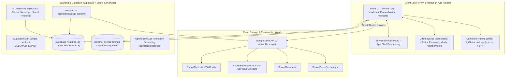

# Sahil's Shore

> **"Your day, your shore."**  
> A private, single-user personal Life OS crafted for full-stack developers. Unifies daily planning, habits, focus tracking, DSA practice, full-stack learning (Spring Boot & MERN), German language acquisition, job applications, expenses in Indian Rupees (paise), dining, travel maps, media vault with Google Drive backup, journal, second brain notes, long-term goals, health mini-trackers, and AI coach insights.

---

## Architecture Overview



---

## Core Modules (16 Modules)

1. **Today Dashboard:** Horizon greeting with time-of-day copy, top 3 priorities, daily todos, habit checklist with flame streaks, focus timer, spend today (INR paise), meals logged, active streaks, and the Unified Timeline.
2. **Todos & Planner:** Natural language parser (`!priority`, `#tags`, `time`, `due date`), List view, Kanban drag-and-drop (`@dnd-kit`), Calendar view, and 30-minute slot Day Planner.
3. **Daily Tracker:** Activities manager (DSA, Spring Boot, MERN, German, Gym...), Pomodoro and stopwatch timers (persists in `localStorage` across page reloads), 52-week GitHub-style activity heatmap, and streak calculations.
4. **DSA Tracker:** CodeMirror syntax editor (Java, Python, JS, TS), 17 core DSA topics, SuperMemo-2 (SM-2) spaced repetition revision queue, weak-topic detection algorithm (< 50% solve rate), and solving streaks.
5. **Full-Stack Learning Hub:** Dual curated tracks ("Java & Spring Boot" with 16 topics; "MERN & TypeScript" with 13 topics), concepts-learned log, project showcase, interview Q&A bank with 1-5 star ratings, mini-project ideas generator, and timed mock technical interview simulator.
6. **German Hub & Pronunciation Lab:** SM-2 vocab cards with color-coded gender articles (`der`, `die`, `das`), audio pronunciation playback, daily German word rotation, CEFR checklist (A1 to B2), and browser Pronunciation Lab with live `<canvas>` waveform visualizer and Shadowing mode.
7. **Resume & Career Hub:** PDF resume versions stored in Google Drive `Shore/Resumes/`, achievement bullet-point power-verb analyzer, 5-stage job application Kanban, overdue follow-up alerts, and STAR behavioral interview practice mode.
8. **Expense Tracker:** Tactile numeric keypad (< 5s log), paise-accurate integer money (`amount_paise bigint`), monthly budget progress bars (green < 80%, amber 80-99%, red 100%+), recurring expenses engine, Indian digit grouping (`₹1,23,456.00`), and CSV export.
9. **Food Diary:** Meal slots (breakfast, lunch, snack, dinner), taste and health ratings, restaurant notes, automatic bidirectional sync with Expense Tracker ("Food" category), and "Places to eat again" directory.
10. **Places & Map:** Leaflet + OpenStreetMap keyless geocoding (Nominatim), category-themed SVG map pins, "Places this month" carousel, vertical travel timeline, and visit detail page.
11. **Media Vault:** Masonry photo gallery grouped by IST calendar day, Lightbox with zoom and video player, Google Drive resumable direct-to-drive uploads, EXIF date and coordinate extraction, and "On this day" memories.
12. **Journal & Reflection:** Daily reflections with mood and energy ratings (1-5), 3 gratitude prompts, wins, lessons, and 1-click "Auto-fill from Timeline".
13. **Notes / Second Brain:** Markdown editor, folder categorization, bidirectional `[[backlinks]]` extractor, backlinks panel, and interactive SVG 2D Knowledge Graph visualizer.
14. **Long-Term Goals:** Goals with milestones, category badges, dynamic progress calculations weighted between milestones (70%) and linked tasks (30%), and Quarterly View (Q1-Q4).
15. **Health Mini-Trackers:** Toggleable trackers for Water hydration (+/- 250ml glasses), Sleep recovery, Workouts, and Weight progression with Recharts trends.
16. **Analytics & AI Coach:** Productivity score formula (40% tasks, 35% focus adherence, 25% habits), 24x7 IST focus heatmap, Pearson correlations (Mood vs. Productivity, Spending vs. Mood), and AI Coach insights with Gemini/Anthropic/Local Heuristic synthesizer and privacy sanitizer.

---

## Backups, Restore & Offline PWA

* **Google Drive Automated Backups:** Weekly Vercel Cron job (`0 2 * * 0`) exports all 37 database tables to `backup.json` and key tables to CSV inside `Shore/Backups/YYYY-MM-DD/`. Automatically retains the 12 most recent backups, pruning older archives.
* **On-Demand Backup & Download:** "Backup Now" button exports directly to Google Drive. "Download (.zip)" exports complete JSON + CSV bundle directly to your local computer.
* **Restore Tool:** Upload `backup.json`, preview table-by-table row counts, and execute restoration using either **Merge** (upsert) or **Replace** (clean wipe & rebuild) strategy.
* **Offline Queue:** Native IndexedDB queue (`shore_offline_db`) caches quick-adds (tasks, expenses, meals, notes, photos) when disconnected. Auto-drains with UUID idempotency keys as soon as connection is re-established.
* **PWA & Web Share Target:** Installable on iOS, Android, and macOS. Registers OS share sheet target (`/share-target`) to capture links and notes directly into Shore.

---

## Global Hotkeys & Command Palette

Press `Cmd + K` or `Ctrl + K` or `/` anywhere to launch the Command Palette:

| Shortcut | Action |
| --- | --- |
| `Cmd + K` or `/` | Open Command Palette & Global Search |
| `n` | Quick Add New Task / Todo |
| `e` | Quick Log Expense (INR paise) |
| `m` | Quick Log Meal |
| `q` | Open Quick Capture Sheet |
| `?` | Open Keyboard Shortcuts Cheat Sheet |
| `g` then `t` | Go to Today Dashboard (`/`) |
| `g` then `d` | Go to DSA Tracker (`/dsa`) |
| `g` then `e` | Go to Expense Tracker (`/expenses`) |
| `g` then `l` | Go to Learning Hub (`/learning`) |
| `g` then `g` | Go to German Hub (`/german`) |
| `g` then `c` | Go to Career Hub (`/career`) |
| `g` then `j` | Go to Journal (`/journal`) |
| `g` then `n` | Go to Notes (`/notes`) |
| `g` then `m` | Go to Media Vault (`/media`) |
| `g` then `p` | Go to Places & Map (`/places`) |
| `g` then `s` | Go to Settings & Backups (`/settings`) |

---

## Setup & Deployment Guide

### 1. Prerequisites
* **Node.js:** 20.x or higher
* **Supabase Project:** Free tier is sufficient
* **Google Cloud Project:** For Google Drive API v3 and Google OAuth sign-in

### 2. Environment Variables Configuration

Copy `.env.example` to `.env.local`:
```bash
cp .env.example .env.local
```

Fill in the environment variables:

| Variable | Description | Source |
| --- | --- | --- |
| `NEXT_PUBLIC_SUPABASE_URL` | Supabase Project URL | Supabase Dashboard > Project Settings > API |
| `NEXT_PUBLIC_SUPABASE_ANON_KEY` | Supabase Public Anon Key | Supabase Dashboard > Project Settings > API |
| `SUPABASE_SERVICE_ROLE_KEY` | Supabase Secret Service Role Key | Supabase Dashboard > Project Settings > API |
| `ALLOWED_EMAIL` | Your authorized Google email | Single-user lock enforcement |
| `NEXT_PUBLIC_APP_URL` | Base application URL | `http://localhost:3000` (or `https://shore.yourdomain.com`) |
| `GOOGLE_CLIENT_ID` | Google OAuth Client ID | Google Cloud Console > Credentials |
| `GOOGLE_CLIENT_SECRET` | Google OAuth Client Secret | Google Cloud Console > Credentials |
| `GOOGLE_DRIVE_REDIRECT_URI` | OAuth Redirect Callback URL | `<APP_URL>/api/drive/callback` |
| `DRIVE_ENCRYPTION_KEY` | AES-256-GCM secret key | 32-byte hex or random string |
| `CRON_SECRET` | Secret token securing Vercel Cron | `openssl rand -hex 32` |
| `GEMINI_API_KEY` | Optional AI Coach API Key | Google AI Studio (or Anthropic API key) |

### 3. Supabase Database Migration

Apply all SQL migrations in chronological order:
```bash
# Using Supabase CLI:
supabase db push

# Or paste migrations sequentially in Supabase Dashboard SQL Editor:
# 1. 20261102000000_schema.sql
# 2. 20261102000001_expenses_and_food.sql
# 3. 20261102060000_dsa_and_learning.sql
# 4. 20261103000000_drive_media_places.sql
# 5. 20261103060000_german_hub.sql
# 6. 20261103120000_career_hub.sql
# 7. 20261104000000_phase10.sql
# 8. 20261104060000_analytics_and_ai_coach.sql
# 9. 20261104120000_backups.sql
```

### 4. Google Cloud Console Configuration

1. In **Google Cloud Console**, enable the **Google Drive API**.
2. Under **APIs & Services > Credentials**, create an **OAuth 2.0 Client ID** (Web application).
   * **Authorized JavaScript Origins:** `http://localhost:3000`, `https://your-vercel-domain.vercel.app`
   * **Authorized Redirect URIs:**
     * `http://localhost:3000/api/drive/callback`
     * `https://your-vercel-domain.vercel.app/api/drive/callback`
     * Also add Supabase Auth callback URL: `https://<supabase-project-id>.supabase.co/auth/v1/callback`
3. **CRITICAL STEP for Single-User Persistence:**
   * Go to **OAuth Consent Screen**.
   * Set Publishing Status to **"In production"** (Click "Publish App").
   * *Note:* Because this is a private single-user app for your own account, Google verification is **not** required. An unverified warning may show once on your initial consent screen. If you leave it in "Testing" mode, Google automatically invalidates refresh tokens after 7 days! Publishing to "In production" ensures your Google Drive sync refresh token remains valid indefinitely.

### 5. Local Development

```bash
# Install dependencies
npm install

# Run unit test suite
npm test

# Start development server
npm run dev
```

Visit `http://localhost:3000`.

### 6. Vercel Deployment

1. Push your repository to GitHub.
2. In **Vercel**, import the repository as a Next.js project.
3. Configure all environment variables from `.env.local` in Vercel Project Settings.
4. Deploy! Vercel will automatically detect `vercel.json` and schedule the weekly backup cron job (`/api/cron/backup`).

---

## Troubleshooting

* **Google Drive Refresh Token Expired:**  
  If Google Drive disconnects or token refresh returns `REVOKED_ACCESS`, ensure your OAuth Consent Screen in Google Cloud Console is set to **"In production"**. Then, visit **Settings > Google Drive Sync**, click "Disconnect", and re-connect to issue a fresh permanent token.
* **Offline Queue Not Syncing:**  
  Click the **Offline / Queued** pill in the top bar to inspect pending items in IndexedDB. Click "Sync Now" to force-drain pending items.
* **Resetting Vault PIN:**  
  Vault PINs for Journal and Expenses are hashed client-side with SHA-256 and salted. If you forget your PIN, you can reset it in **Settings > Privacy & Vault**.

---

**Sahil's Shore** — Built with precision, coastal calm, and uncompromising craft.
